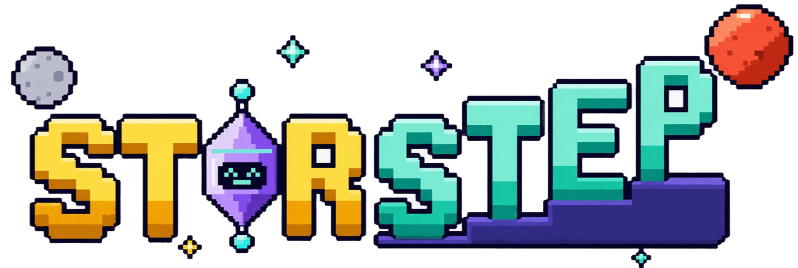
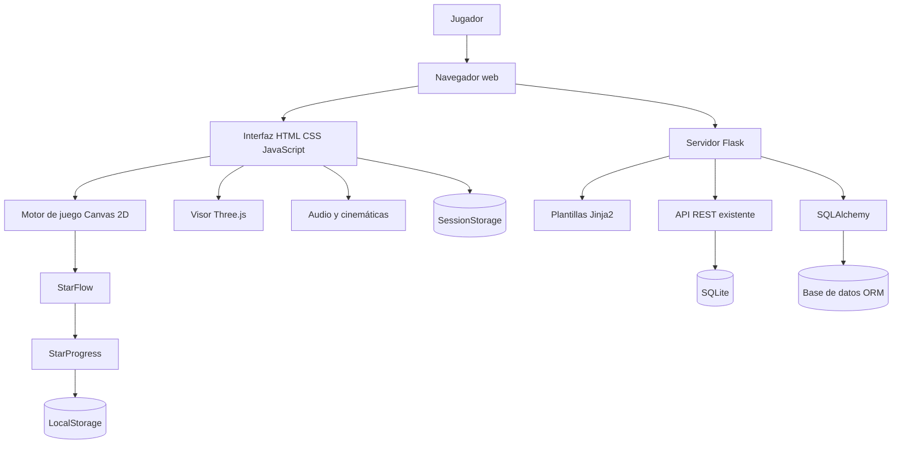
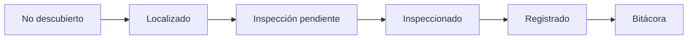

# 🚀 StarStep

**Capítulo 1 — Rock & Roll**

*Un pequeño paso que dar, un universo por explorar.*




Videojuego educativo web desarrollado por **OUTSTRIP**, en el contexto de **NASA Space Apps Challenge 2026 — Managua, Nicaragua**, para el reto *Abandoned but not Forgotten*.

---

## 🌌 1. Descripción del proyecto

StarStep es un videojuego educativo de exploración espacial con estética pixel art, diseñado para acercar a niños y adolescentes a la ciencia, la tecnología, la geología planetaria y la historia de la exploración espacial.

El jugador asume el papel de un cadete acompañado por **Lito**, un robot geólogo cuyo nombre proviene del griego *lithos*, que significa piedra.

Juntos emprenden una aventura por la Luna y Marte, investigando los instrumentos, vehículos y objetos que la humanidad ha dejado en otros mundos.

Estos objetos no se presentan como simple chatarra espacial, sino como patrimonio científico y testigos de importantes descubrimientos.

StarStep combina:

- Narración interactiva.
- Exploración espacial.
- Animaciones pixel art.
- Cinemáticas históricas.
- Fotografías documentales de la NASA.
- Visualización interactiva de modelos 3D.
- Minijuegos científicos.
- Resolución de problemas.
- Recolección y clasificación de evidencias.
- Certificados educativos.

> Abandonados, pero jamás olvidados.

---

## 🎯 2. Objetivos

### Objetivo general

Desarrollar una experiencia educativa interactiva que permita comprender la importancia científica e histórica de los instrumentos y vehículos de exploración espacial mediante el aprendizaje basado en videojuegos.

### Objetivos específicos

- Promover el interés por las disciplinas STEM.
- Explicar los descubrimientos realizados por Apollo 11 y Opportunity.
- Enseñar conceptos fundamentales de geología planetaria.
- Desarrollar habilidades de observación, análisis y pensamiento crítico.
- Diferenciar las evidencias científicas de las interpretaciones y simulaciones narrativas.
- Fomentar la valoración del patrimonio de la exploración espacial.
- Proporcionar una experiencia educativa bilingüe, interactiva y accesible.

---

## 🎮 3. Experiencia de juego

El videojuego está organizado en capítulos y actos que representan diferentes etapas del aprendizaje científico.

### Estación terrestre

El punto de partida de la aventura.

Incluye:

- Presentación del equipo OUTSTRIP.
- Selección de idioma.
- Introducción histórica.
- Bienvenida de Lito.
- Personalización del cadete.
- Selección de capítulos.
- Configuración de música, voz y efectos sonoros.
- Acceso a la bitácora y al Archivo NASA.

### Capítulo 01 — Rock & Roll

**Dos mundos, dos historias: las huellas del pasado.**

El jugador se convierte en detective de rocas y viaja hacia la Luna y Marte para comprender cómo las evidencias geológicas permiten reconstruir la historia de otros mundos.

#### Prólogo — Preparación de la misión

- Cinemática introductoria.
- Presentación de los objetivos.
- Diálogos con Lito.
- Cuenta regresiva.
- Despegue.
- Viaje espacial.
- Minijuego de navegación y obstáculos.
- Aproximación y alunizaje.

#### Acto I — Luna: Detective de lava

Inspirado en la misión Apollo 11.

El jugador realiza actividades como:

- Exploración de la superficie lunar.
- Administración del oxígeno.
- Recolección de muestras.
- Inspección del módulo lunar Eagle.
- Investigación de la placa conmemorativa.
- Instalación del paquete experimental EASEP.
- Instalación y orientación del retrorreflector láser LRRR.
- Ascenso y acoplamiento con Columbia.
- Análisis del basalto lunar en el laboratorio.
- Obtención de un diploma lunar.

#### Transición interplanetaria

Una secuencia narrativa conecta el cierre de la investigación lunar con la siguiente aventura.

El diseño contempla:

- Finalización del laboratorio lunar.
- Narración de Lito.
- Despegue automático de la nave ficticia StarStep.
- Viaje interplanetario.
- Planetas animados.
- Aproximación a Marte.
- Transición a la cinemática de Opportunity.

Esta secuencia representa una conexión narrativa entre dos misiones históricas diferentes.

#### Acto II — Marte: Detective de agua

Inspirado en la misión Mars Exploration Rover Opportunity.

El jugador investiga:

- Aterrizaje de Opportunity.
- Exploración del cráter Eagle.
- Administración de energía.
- Desplazamiento del rover.
- Esférulas de hematita, conocidas como blueberries.
- Evidencias de sulfatos.
- Yeso y arcillas.
- Instrumentos científicos.
- Condiciones de habitabilidad.
- Tormenta global de polvo de 2018.
- Obtención del diploma marciano.

#### Acto III — Huellas

Etapa dedicada a relacionar los descubrimientos obtenidos durante ambos actos.

Incluye:

- Asociación de evidencias.
- Comparación de objetos científicos.
- Conexión Eagle–Eagle.
- Aplicación del método científico.
- Reflexión sobre la exploración espacial.
- Obtención del certificado del capítulo.

### Próximos capítulos

| Capítulo | Nombre | Estado |
|---|---|---|
| 01 | Rock & Roll | Prototipo funcional |
| 02 | Ruedas y polvo | Planificado |
| 03 | Señales lejanas | Planificado |

---

## 🔬 4. Enfoque científico y educativo

StarStep distingue tres categorías fundamentales:

| Categoría | Significado | Color |
|---|---|---|
| O — Observado | Evidencias obtenidas directamente mediante observaciones o mediciones. | Cian |
| I — Interpretado | Explicaciones científicas construidas a partir de evidencias. | Violeta |
| N — Narrativa | Simulaciones, simplificaciones y elementos ficticios del videojuego. | Amarillo |

El propósito de esta clasificación es enseñar que una observación científica no es necesariamente equivalente a una conclusión.

### Rigor histórico

Las misiones Apollo 11 y Opportunity forman parte de la historia real de la exploración espacial.

Sin embargo, StarStep incorpora elementos ficticios y simplificaciones para facilitar el aprendizaje y la jugabilidad.

Por ejemplo:

- Los tiempos de oxígeno son simulados.
- Las distancias espaciales se encuentran comprimidas.
- El vehículo utilizado en la exploración lunar es una mecánica narrativa.
- Apollo 11 no utilizó un rover lunar.
- Apollo 11 no viajó posteriormente a Marte.
- Lito y la nave StarStep son personajes y elementos originales del videojuego.

Las simulaciones no deben interpretarse como reproducciones históricas exactas.

---

## ⚙️ 5. Arquitectura tecnológica

StarStep utiliza una arquitectura web cliente-servidor.

El backend está desarrollado en Python mediante Flask, mientras que la interfaz y las principales mecánicas del videojuego se ejecutan en el navegador mediante JavaScript.

### Tecnologías utilizadas

| Tecnología | Función |
|---|---|
| Python | Lenguaje principal del backend. |
| Flask | Framework de aplicación web y rutas HTTP. |
| Jinja2 | Renderizado dinámico de plantillas HTML. |
| HTML5 | Estructura de las interfaces. |
| CSS3 | Identidad visual, animaciones y diseño responsive. |
| JavaScript | Lógica del videojuego y control de interacciones. |
| Canvas 2D | Escenarios, personajes, planetas y minijuegos. |
| Three.js | Visualización de modelos tridimensionales. |
| GLB / glTF | Formatos de modelos 3D. |
| SQLite | Almacenamiento de datos del servidor. |
| SQLAlchemy | Gestión de modelos y relaciones de datos. |
| Flask-Migrate | Administración de migraciones de base de datos. |
| LocalStorage | Persistencia local del jugador y progreso. |
| SessionStorage | Control temporal de sesiones y navegación. |
| Web Audio API | Música y efectos sonoros. |
| Speech Synthesis API | Síntesis de voz de Lito. |
| Node.js | Ejecución de pruebas automatizadas JavaScript. |
| Git | Control de versiones. |
| GitHub | Repositorio y colaboración del equipo. |

### Diagrama de arquitectura



La mayor parte del estado de la partida invitada se conserva actualmente en el navegador.

La API y los modelos relacionales existentes constituyen una base para futuras funcionalidades de persistencia autenticada.

---

## 🧠 6. Motor de progreso — StarFlow

StarFlow es el controlador central encargado de administrar las etapas, objetivos, requisitos y recompensas del videojuego.

Sus principales archivos son:

- `static/js/flujo-definicion.js`
- `static/js/flujo.js`
- `static/js/progreso.js`

### Responsabilidades

- Controlar el avance de las misiones.
- Validar los requisitos de cada etapa.
- Evitar registros duplicados de objetivos.
- Administrar los descubrimientos.
- Gestionar el desbloqueo de contenido.
- Conservar el progreso.
- Permitir la recuperación después de recargar una página.
- Controlar el acceso a los actos.
- Gestionar la finalización de capítulos.

### Ciclo de descubrimiento de artefactos



La consulta de un artefacto desde la bitácora no debe generar un descubrimiento adicional.

Las reglas de StarFlow controlan la progresión del juego en el cliente y no sustituyen los mecanismos de seguridad del servidor.

---

## 📁 7. Estructura del repositorio

```text
StarStep/
│
├── app.py
├── extensions.py
├── requirements.txt
├── README.md
├── .gitignore
│
├── database/
├── models/
├── migrations/
│
├── docs/
│   └── FLUJO_OFICIAL.md
│
├── templates/
│   ├── index.html
│   ├── astronauta.html
│   ├── capitulos.html
│   ├── rock-roll.html
│   ├── despegue.html
│   ├── vuelo.html
│   ├── luna.html
│   ├── marte.html
│   ├── huellas.html
│   ├── bitacora.html
│   └── archivo-nasa.html
│
├── static/
│   │
│   ├── assets/
│   │   ├── branding/
│   │   ├── models/
│   │   ├── nasa/
│   │   └── videos/
│   │
│   ├── css/
│   │   ├── identidad.css
│   │   ├── paleta.css
│   │   ├── componentes.css
│   │   ├── capitulos.css
│   │   ├── mision.css
│   │   └── ...
│   │
│   ├── js/
│   │   ├── main.js
│   │   ├── audio.js
│   │   ├── progreso.js
│   │   ├── flujo.js
│   │   ├── flujo-definicion.js
│   │   ├── scene.js
│   │   ├── planetas.js
│   │   ├── juego/
│   │   └── ...
│   │
│   └── vendor/
│       └── three/
│
├── instance/
│
└── tests/
    ├── js/
    └── test_rutas.py
```

---

## 💻 8. Instalación y ejecución

### Requisitos previos

- Python 3.10 o superior, compatible con las dependencias.
- Git.
- Navegador web moderno.
- Node.js 22 o superior recomendado para las pruebas.
- Soporte WebGL para los modelos tridimensionales.

### Windows — Git Bash

Ubicarse en la carpeta raíz del proyecto.

Crear un entorno virtual:

```bash
python -m venv .venv
```

Activar el entorno virtual:

```bash
source .venv/Scripts/activate
```

Instalar las dependencias:

```bash
python -m pip install --upgrade pip
python -m pip install -r requirements.txt
```

Ejecutar el servidor:

```bash
python app.py
```

### Linux y macOS

```bash
python3 -m venv .venv
source .venv/bin/activate
python -m pip install -r requirements.txt
python app.py
```

### Acceder al videojuego

Abrir la siguiente dirección en el navegador:

```text
http://127.0.0.1:5000/
```

No es necesario instalar dependencias npm para ejecutar el frontend, debido a que Three.js se encuentra incluido entre los recursos del proyecto.

Node.js se utiliza principalmente para las pruebas automatizadas.

El servidor de desarrollo de Flask no está diseñado para utilizarse directamente en producción.

---

## 🌐 9. Rutas principales

| Ruta | Descripción |
|---|---|
| `/` | Portada y estación terrestre. |
| `/astronauta` | Personalización del cadete. |
| `/capitulos` | Selector de capítulos. |
| `/rock-roll` | Introducción del capítulo. |
| `/despegue` | Lanzamiento y descenso lunar. |
| `/vuelo` | Minijuego de viaje espacial. |
| `/luna` | Acto I y misiones lunares. |
| `/marte` | Acto II y misiones marcianas. |
| `/huellas` | Acto III y método científico. |
| `/bitacora` | Registro de evidencias y reconocimientos. |
| `/archivo-nasa` | Archivo científico y documental. |

### API existente

| Método HTTP | Endpoint | Función |
|---|---|---|
| GET | `/api/health` | Verificar disponibilidad del servidor. |
| GET / POST | `/api/progreso` | Consultar y actualizar registros del jugador. |
| POST | `/api/descubrimiento` | Registrar descubrimientos. |
| GET / POST | `/api/bitacora` | Consultar y actualizar anotaciones y actos. |

La API existente requiere mejoras adicionales de autenticación, autorización y validación antes de una implementación pública.

---

## 🗃️ 10. Persistencia de datos

StarStep dispone de mecanismos de almacenamiento local y modelos de almacenamiento en el servidor.

### Almacenamiento local

LocalStorage permite conservar:

- Identificador del jugador invitado.
- Alias.
- Avatar.
- Progreso de las misiones.
- Artefactos registrados.
- Inventario.
- Anotaciones.
- Preferencias de idioma.
- Configuración de audio.

SessionStorage administra marcas temporales asociadas a la navegación y presentación del juego.

### Base de datos

El proyecto utiliza SQLite y SQLAlchemy.

Actualmente existen dos mecanismos de almacenamiento SQLite:

- `starstep.db`: base de datos heredada.
- `instance/starstep.db`: base de datos asociada a los modelos ORM.

La autenticación real, recuperación de cuentas y sincronización segura del progreso con el servidor permanecen como funcionalidades pendientes de consolidación.

---

## 📖 11. Bitácora científica

La bitácora, también denominada Librito, funciona como un registro educativo de los descubrimientos realizados por el jugador.

Contiene:

- Artefactos lunares.
- Instrumentos marcianos.
- Evidencias científicas.
- Fotografías históricas.
- Anotaciones del cadete.
- Estado de las misiones.
- Modelos tridimensionales.
- Diplomas y certificados.

Su objetivo es permitir que el jugador consulte y repase los conocimientos adquiridos durante la aventura.

---

## 🏆 12. Sistema de reconocimientos

StarStep contempla tres reconocimientos principales:

| Reconocimiento | Requisito |
|---|---|
| Diploma lunar | Completar la investigación del Acto I. |
| Diploma marciano | Completar la investigación del Acto II. |
| Certificado Rock & Roll | Completar el recorrido científico del capítulo. |

Los reconocimientos se encuentran vinculados a los objetivos educativos y al progreso legítimo del jugador.

Estos certificados son reconocimientos internos del videojuego y no constituyen certificaciones oficiales de la NASA.

---

## 🎨 13. Identidad visual

El proyecto utiliza una estética pixel art inspirada en videojuegos clásicos, combinada con interfaces espaciales modernas.

### Paleta de colores

| Color | Código hexadecimal | Uso |
|---|---|---|
| Azul noche | `#0E1233` | Fondo principal. |
| Azul panel | `#1A1F4D` | Paneles e interfaces. |
| Azul elevado | `#262C66` | Componentes interactivos. |
| Violeta oscuro | `#1A1340` | Bordes y sombras. |
| Violeta | `#ABA1F5` | Identidad visual. |
| Menta | `#8FF0D8` | Acciones principales. |
| Crema | `#FFF8E7` | Texto principal. |
| Gris lunar | `#C3C7D6` | Superficie lunar. |
| Amarillo | `#FFE066` | Identidad lunar. |
| Rojo marciano | `#D9593A` | Identidad de Marte. |
| Cian | `#3FD0E0` | Evidencias observadas y agua. |

### Principios de diseño

- Interfaz amigable para niños y adolescentes.
- Escenarios animados.
- Personajes expresivos.
- Iconografía consistente.
- Identidad diferenciada para cada planeta.
- Fotografías documentales integradas.
- Controles adaptados a distintos dispositivos.
- Narración bilingüe.
- Preferencias de movimiento reducido cuando corresponda.

---

## 🧪 14. Pruebas automatizadas

El proyecto incluye pruebas de JavaScript mediante Node.js y pruebas del backend mediante Python unittest.

### Pruebas JavaScript

```bash
node --test tests/js/*.test.mjs
```

### Pruebas Python

```bash
python -m unittest tests.test_rutas -v
```

### Validación de cambios Git

```bash
git diff --check
```

### Generar informe de pruebas en Windows

```bash
node.exe --test --test-reporter=tap tests/js/*.test.mjs > resultado-pruebas.txt 2>&1

grep -E '^(not ok|# (tests|pass|fail))' resultado-pruebas.txt
```

Las pruebas comprenden:

- Validación de objetivos.
- Navegación.
- Persistencia.
- Control de etapas.
- Registro de artefactos.
- Minijuegos.
- Cinemáticas.
- Recompensas.
- Rutas Flask.
- API existente.

Las pruebas automatizadas deben complementarse con verificaciones visuales y funcionales en el navegador.

---

## 🤖 15. Declaración de uso de inteligencia artificial

El equipo OUTSTRIP declara de manera transparente que durante el desarrollo de StarStep se utilizaron herramientas de inteligencia artificial generativa como asistentes de apoyo técnico, creativo y documental.

### Herramientas utilizadas

- ChatGPT — OpenAI.
- Claude — Anthropic.

### Áreas de utilización

La inteligencia artificial fue utilizada como apoyo en:

- Planificación técnica del proyecto.
- Generación y refactorización de código.
- Desarrollo de componentes HTML, CSS y JavaScript.
- Asistencia en programación con Python y Flask.
- Identificación y resolución de errores.
- Diseño de interfaces y propuestas visuales.
- Desarrollo de animaciones y elementos interactivos.
- Organización de la arquitectura del videojuego.
- Creación y adaptación de pruebas automatizadas.
- Revisión de textos y diálogos bilingües.
- Elaboración de documentación técnica.
- Integración de módulos.
- Orientación en el uso de Git y GitHub.

### Responsabilidad humana

El uso de estas herramientas no sustituye la participación, la creatividad ni la responsabilidad del equipo desarrollador.

El equipo OUTSTRIP es responsable de:

- Definir los objetivos educativos.
- Tomar las decisiones de diseño.
- Seleccionar y verificar las fuentes científicas.
- Revisar el código generado o sugerido.
- Integrar las funcionalidades.
- Realizar pruebas.
- Validar la experiencia del usuario.
- Evaluar la precisión del contenido.
- Garantizar la calidad del producto final.

Los contenidos generados con asistencia de inteligencia artificial no constituyen por sí mismos evidencia científica y deben ser revisados antes de su publicación.

La inteligencia artificial fue utilizada como herramienta de asistencia durante el proceso de desarrollo.

La ejecución del videojuego no requiere una conexión directa con las API de ChatGPT o Claude.

La narración de Lito utiliza las capacidades de síntesis de voz disponibles en el navegador del usuario.

---

## 🛰️ 16. Fuentes científicas

El contenido educativo está inspirado en información y recursos documentales de instituciones científicas, principalmente:

- NASA.
- NASA Jet Propulsion Laboratory (JPL).
- NASA Science.
- NASA Space Science Data Coordinated Archive (NSSDCA).
- NASA Lunar Sample Compendium.
- NASA Image and Video Library.
- NASA/JPL Photojournal.

### Enlaces de referencia

- https://www.nasa.gov/
- https://science.nasa.gov/
- https://www.jpl.nasa.gov/
- https://images.nasa.gov/
- https://nssdc.gsfc.nasa.gov/
- https://photojournal.jpl.nasa.gov/

Las fotografías, modelos y recursos audiovisuales de terceros deben conservar sus respectivos créditos, identificadores y condiciones de utilización.

La utilización de material de la NASA no implica patrocinio, aprobación ni afiliación oficial.

---

## 👨‍🚀 17. Equipo desarrollador

### OUTSTRIP

**NASA Space Apps Challenge 2026**

**Managua, Nicaragua**

Integrantes:

- Ariel Talavera.
- Liliana Perez.
- Kevin Flores.
- Dannia Perez.
- Willam Perez.
- Samantha Perez.

Equipo multidisciplinario orientado al desarrollo de soluciones tecnológicas, educativas y creativas relacionadas con la exploración espacial.

---

## 📌 18. Estado del proyecto

StarStep se encuentra en una etapa de prototipo funcional y desarrollo acumulativo.

El proyecto contempla veinte módulos de trabajo relacionados con la identidad visual, narrativa, experiencia educativa, mecánicas, interfaces y documentación.

### Funcionalidades trabajadas

- Identidad visual global.
- Introducción histórica.
- Estación terrestre.
- Personalización del cadete.
- Selector de capítulos.
- Prólogo Rock & Roll.
- Despegue.
- Viaje espacial.
- Alunizaje.
- Exploración lunar.
- Instrumentos científicos.
- Ascenso y acoplamiento.
- Laboratorio lunar.
- Transición narrativa hacia Marte.
- Exploración marciana.
- Enigmas científicos.
- Tormenta de polvo.
- Asociación de evidencias.
- Bitácora y reconocimientos.
- Archivo NASA, créditos y visualización 3D.

### Trabajo pendiente

- Validación integral de todos los módulos.
- Optimización del rendimiento.
- Correcciones visuales y funcionales.
- Consolidación de cuentas de usuario.
- Autenticación y recuperación de contraseñas.
- Sincronización segura del progreso.
- Validación de la persistencia de certificados.
- Mejoras de accesibilidad.
- Verificación de compatibilidad móvil.
- Revisión de licencias de recursos multimedia.
- Desarrollo de capítulos posteriores.

El estado actual no implica que todas las funcionalidades hayan superado una validación definitiva en producción.

---

## 🔐 19. Seguridad y privacidad

StarStep está dirigido principalmente a un público educativo.

Por ello, se busca minimizar la recopilación de datos personales y utilizar únicamente la información necesaria para la experiencia del jugador.

Antes de una publicación definitiva deberán implementarse y verificarse:

- Autenticación segura.
- Protección de contraseñas.
- Validación de datos del servidor.
- Autorización de operaciones.
- Protección de información personal.
- Gestión segura de sesiones.
- Políticas de privacidad.
- Protección de datos de usuarios menores de edad.

La aplicación debe considerarse un prototipo de desarrollo mientras estas funcionalidades no estén completamente consolidadas.

---

## 📜 20. Licencia y derechos de autor

StarStep es un proyecto educativo independiente desarrollado por OUTSTRIP.

Los recursos originales del videojuego, personajes, interfaces, código y elementos narrativos están sujetos a las decisiones de licencia del equipo desarrollador.

Las fotografías, videos, modelos tridimensionales, bibliotecas y demás recursos pertenecientes a terceros mantienen sus respectivas condiciones de utilización.

Three.js se distribuye bajo licencia MIT.

La licencia general del repositorio deberá ser definida expresamente por el equipo antes de su distribución definitiva.

### Aviso de independencia

**StarStep no es un videojuego, producto ni sitio web oficial de la NASA.**

Este proyecto utiliza información científica y recursos documentales con fines educativos.

---

## 💜 Agradecimientos

A la comunidad científica, ingenieros, investigadores, astronautas y profesionales que han contribuido al conocimiento del universo.

A todas las personas que creen que la educación, la ciencia y la tecnología pueden transformar la manera en que comprendemos nuestro mundo y los mundos que todavía nos quedan por explorar.

---

<div align="center">

### ⭐ StarStep: Two Worlds, Two Stories

Desarrollado por **OUTSTRIP**
*Integrantes:*
- Willian Perez
- Dannia Perez
- Liliana Perez
- Samantha Perez
- Ariel Talavera
- Kevin Flores
  
Managua, Nicaragua — 2026

</div>
